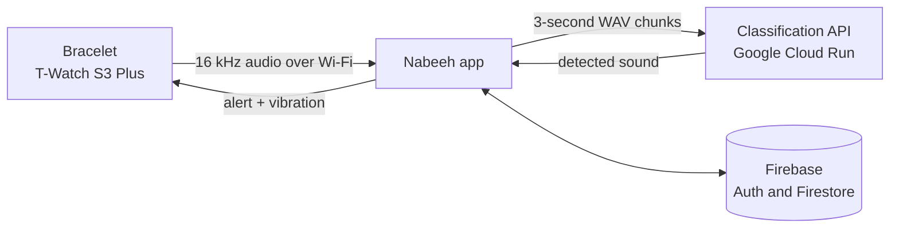

# Nabeeh | نبيه

Nabeeh is an assistive system for deaf and hard-of-hearing (DHH) users. A wearable bracelet listens to the sounds around the user, and this Android application classifies them and alerts the user to the important ones through vibration and on-screen notifications. The application is fully in Arabic.

This repository contains the Flutter mobile application and the Firebase Cloud Functions. The bracelet firmware is in a separate repository: [Nabeeh-Watch](https://github.com/lRenadl/Nabeeh-Watch).

## Detected Sounds

| Sound | Alert behaviour |
|---|---|
| Fire alarm | Always enabled in every audio group |
| Baby cry | Configurable per audio group |
| Doorbell | Configurable per audio group |
| Door knock | Configurable per audio group |
| Athan | Configurable per audio group |

The model also recognizes two non-alert classes: Quran recitation, which is often confused with the Athan, and background sounds, which cover everyday noise that should not alert the user.

## How It Works



1. The bracelet streams 16 kHz, 16-bit mono audio to the app over a paired and authenticated TCP connection on the local Wi-Fi network.
2. The app cuts the stream into 3-second chunks and sends each chunk to the classification API.
3. If the detected sound is enabled in the active audio group, the app shows an alert and the bracelet vibrates with the group's vibration settings.

## Features

- **Accounts:** sign up and log in with email or Google, email verification, password reset, edit name and email, change password, and delete account.
- **Sound monitoring:** start and stop listening, background listening with a status notification, and a live list of detected sounds.
- **Audio groups:** custom groups with per-sound on/off and vibration strength, one active group at a time, and automatic activation when the user reaches a saved location.
- **Reminders:** one-time or repeating reminders with a label and vibration strength. Reminders are sent to the bracelet and fire from its own clock, even when the phone is away.
- **Emergency:** emergency contacts and an SOS button that sends an SMS with the user's location after a short countdown.
- **Communication:** speech-to-text and text-to-speech.
- **Bracelet:** Wi-Fi setup and secure pairing, connection status, battery level, and low-battery alerts.
- **Accessibility:** sign language explanation videos for each page, and an FAQ page.

## Technologies

| Part | Technology |
|---|---|
| Mobile app | Flutter (Dart), Android |
| Backend | Firebase Authentication, Cloud Firestore, Cloud Functions (Node.js 22) |
| Sound classification | Python, TensorFlow, YAMNet embeddings with a trained classifier head, served on Google Cloud Run |
| Speech | Azure Speech Services (speech-to-text), ElevenLabs (text-to-speech) |
| Maps | OpenStreetMap through `flutter_map` and `geolocator` |
| Bracelet | LILYGO T-Watch S3 Plus (ESP32-S3), see [Nabeeh-Watch](https://github.com/lRenadl/Nabeeh-Watch) |

## Project Structure

| Path | Description |
|---|---|
| `lib/main.dart` | App entry point |
| `lib/screens/` | All app screens (accounts, listening, audio groups, reminders, emergency, communication, bracelet, FAQ) |
| `lib/services/` | Bracelet connection and pairing (`watch_link.dart`, `watch_auth.dart`, `watch_audio_socket.dart`, `wifi_provisioning_service.dart`), background listening, classification API client, reminders, location-based groups |
| `lib/features/categories/` | Data layer for audio groups (models, Firestore data source, service) |
| `lib/widgets/` | Shared widgets, including the sign language video components |
| `assets/` | Fonts, images, and sign language videos |
| `functions/` | Firebase Cloud Functions that send the app's emails (verification, password reset, welcome) |

## Getting Started

### Requirements

- Flutter SDK (Dart 3.11 or later) and Android Studio
- A physical Android phone. The emulator cannot connect to the bracelet.
- A Firebase project, with the Firebase CLI and FlutterFire CLI installed
- Node.js 22, only if you deploy the Cloud Functions

### Run the App

1. Clone the repository and install the dependencies:
   ```bash
   git clone https://github.com/raghadzworld/nabeeh_app.git
   cd nabeeh_app
   flutter pub get
   ```
2. Connect the app to your Firebase project. This generates `lib/firebase_options.dart` and `android/app/google-services.json`:
   ```bash
   flutterfire configure
   ```
3. Create `lib/secrets.dart` with your own API keys. This file is listed in `.gitignore` and must never be committed:
   ```dart
   const String kElevenLabsKey = 'YOUR_ELEVENLABS_KEY';
   const String kAzureSpeechKey = 'YOUR_AZURE_SPEECH_KEY';
   ```
4. Connect your phone and run the app:
   ```bash
   flutter run
   ```

### Deploy the Cloud Functions (optional)

Create `functions/.env` with the Gmail account used to send the app's emails, then deploy:

```bash
cd functions
npm install
# functions/.env
# GMAIL_USER=your-address@gmail.com
# GMAIL_PASS=your-app-password
firebase deploy --only functions
```

### Connect the Bracelet

1. Flash the firmware from the [Nabeeh-Watch](https://github.com/lRenadl/Nabeeh-Watch) repository.
2. On the bracelet, open Settings, tap «شبكة الإنترنت», then «تغيير الشبكة».
3. On the phone, join the network shown on the bracelet, choose your Wi-Fi network, and enter its password and the setup code shown on the bracelet.
4. Make sure the phone is on the same Wi-Fi network, then open the app. Pairing happens automatically, and the Watch page shows the status «متصلة».

## Classification API

The app sends each audio chunk to the API defined in `lib/services/event_classifier_service.dart`.

- **Endpoint:** `POST /predict_stream`
- **Request:** multipart form with a WAV file in the field `file` (16 kHz mono, 3 seconds)
- **Response:** JSON with `label`, `should_alert`, and `fire_alarm_safety_flag`

The model behind the API uses YAMNet embeddings with a trained classifier head. It reached 85.85% accuracy on the public test set and 80.56% on bracelet recordings from sources it never heard during training.

## Team

- Abeer Alsahli
- Renad Alowais
- Ragad Alrashid
- Ruba Alrzouq

**Supervisor:** Dr. Noura Alhakbani

King Saud University, College of Computer and Information Sciences, Information Technology Department
IT497: Graduation Project 2, Fall 2026
